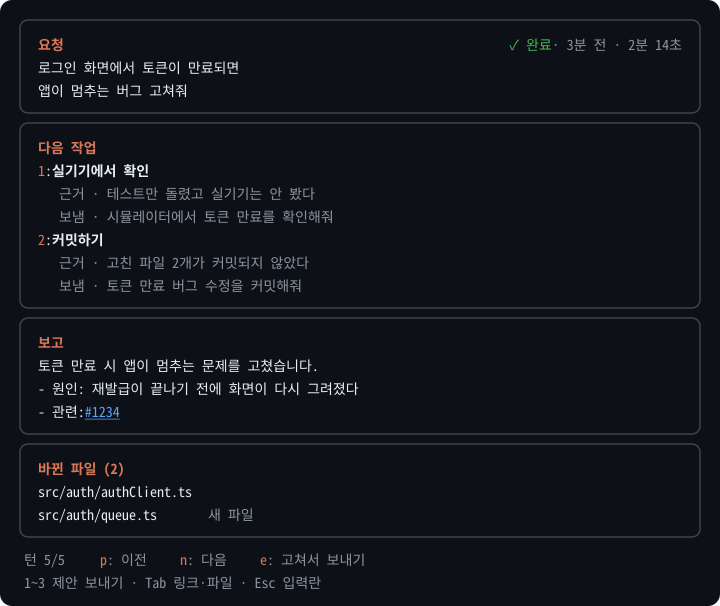

# turn-panel

**English** · [한국어](README.ko.md)

A Claude Code mod that pins each session's request and completion report together in a panel, with live progress and up to three next-step suggestions — each showing the reason behind it and the exact text it will send.

When you juggle several Claude Code sessions, coming back to one usually means scrolling up to remember what you asked and what got done. turn-panel keeps that in a panel: what you asked, what finished (or what is running right now), and what to do next — and you pick it from the keyboard.

<p align="center">
  
</p>

> The panel's UI text is in Korean.

## Features

- **Request and report, together** — the turn's request (line breaks kept), its status (done · 3 min ago · 2m 14s), and the final report.
- **Live progress** — while a turn runs: what Claude is doing right now (reading a file, running a command, …), the elapsed time, and a checklist when Claude keeps a task list.
- **Next steps with reasons** — up to three suggestions, each with a short label, the reason, and the full text that will be sent.
- **First suggestion in the prompt** — when a turn ends, the first suggestion appears as the dim suggestion in the prompt box. Press `Tab` to take it, read it, then `Enter`.
- **Answer choices** — when Claude ends with a question, the suggestions are the answers you would give (e.g. "Plan B", "skip the docs"), so a short reply is one key away.
- **History after a restart** — reopen a session (`--resume`, `--continue`, cmux session restore) and the panel brings back its recent turns from the conversation Claude Code already saved.
- **Links** — URLs, `#123`, and `owner/repo#123` in the report become clickable; URLs open in a cmux browser pane. Files mentioned in the report are listed in a **Links** box and open in your editor at the right line.
- **Tables that fit** — Markdown tables in the report are drawn to the panel's width, wrapping long cells inside their column.
- **Changed files** — files edited or created during the turn, including by subagents.
- **History** — the last 20 turns of the session, browsable with `p` / `n`.
- **Keyboard-first** — reach the panel with `ctrl+x tab`, pick with `1`–`3`, return with `Esc`.
- **Works remotely** — when you watch a session from the desktop app, the web, or mobile, links open on the device you are looking at.

## Requirements

- Claude Code **2.1.296** or later, in a terminal session. The mod API is in early access; this mod was built and tested on 2.1.296.
- macOS (`open` is used to open links and files).
- Optional: the cmux terminal (opens URLs in a browser pane inside the workspace) and your editor's command-line launcher (`webstorm`, `code`, or `cursor`). The panel works without them.

## Install

In a Claude Code session started from a terminal:

```
/plugin install turn-panel --marketplace JunH-K/claude-turn-panel
```

Answer `y` to add the marketplace and choose the **user** scope. It is active in that session right away and in every session you start afterwards; sessions that were already open need a restart.

Or from a shell:

```bash
claude plugin marketplace add JunH-K/claude-turn-panel
claude plugin install turn-panel@claude-turn-panel
```

`1 userConfig option not yet set` only means the editor option was left at its default (`webstorm`).

Check it with `claude plugin list` (`turn-panel@claude-turn-panel` should be `enabled`), or type `/turn-panel` in a session.

## Usage

The panel opens by itself when a turn starts or ends. If the terminal is too narrow, the status line shows `/turn-panel` instead.

### Commands

| Command | What it does |
| --- | --- |
| `/turn-panel` | Opens the panel with keyboard focus, or closes it if it is open. A panel you close stays closed until you open it again. |
| `/turn-panel off` | Turns the mod off for this session: no panel, no suggestion block. |
| `/turn-panel on` | Turns it back on. |

### Keys

Moving between the prompt and the panel uses Claude Code's built-in keys:

| Key | Action |
| --- | --- |
| `Tab` (in the prompt) | Take the first suggestion shown dimmed in the empty prompt box |
| `ctrl+x`, then `tab` | Prompt → panel. Release `ctrl+x`, then press `tab` within 3 seconds. |
| `Esc` | Panel → prompt |
| `ctrl+x`, then `x` | Close the panel (while it has focus) |
| `ctrl+x`, then `←` / `→` | Widen / narrow the panel. The width is remembered. |

While the panel has focus:

| Key | Action |
| --- | --- |
| `1`–`3` | Send that suggestion as your next request. A suggestion starting with `/` goes into the prompt instead — press Enter to run it. |
| `e`, then `1`–`3` | Put the suggestion into the prompt so you can edit it first |
| `p` / `n` | Previous / next turn |
| `Tab`, arrows, `Enter` | Move to a link or changed file and open it |

## Configuration

Change it in `/config`.

| Option | Values | Default |
| --- | --- | --- |
| Editor for files (`editor`) | `webstorm`, `vscode`, `cursor`, `system` | `webstorm` |

`webstorm`, `vscode`, and `cursor` use their command-line launchers. If the launcher is missing, or with `system`, files open in your default **text editor** (`open -t`) — never in the file's default app, so opening a file can't run a script.

## How it works

The mod adds one section to the system prompt asking Claude to end a work report with a block like this:

````
```next
short label | one-sentence reason => the exact request to send
```
````

When Claude ends with a question, the lines are the answers you might give instead. The panel reads the block into the **Next steps** box, puts the first line in the prompt box as a dim suggestion, and hides the block from the transcript; the stored message keeps it (`ctrl+o` shows it). The block is hidden only while the panel can show it instead — if the panel is closed or the block is malformed, the transcript shows it as written.

`/turn-panel off` drops the section from the next turn and leaves Claude Code's own prompt suggestions alone. Headless runs (`claude -p`, the SDK) are left alone entirely.

When a session is reopened, the panel rebuilds its last 20 turns from the conversation Claude Code saved (`$.session.messages()`). Restored turns show as "이전 실행" (previous run), since their timing is not saved.

## Safety

Suggestions are written by the model, and the model can be steered by text it reads (files, web pages, tool output). turn-panel makes sure nothing acts without you seeing it first:

- The full text a suggestion will send is shown before you press its key.
- Slash-command suggestions never run directly — they go into the prompt and wait for Enter. They are never shown as the dim prompt suggestion.
- The dim prompt suggestion only fills the prompt box; nothing is sent until you press Enter.
- Answer choices never approve hard-to-undo actions (push, deploy, delete, sending data out) — you type those yourself.
- Suggestions longer than 300 characters, starting with `!`, or containing invisible or deceptive characters are dropped.
- Presses within 1.5 seconds of the suggestions changing are ignored.
- File paths in the report are never turned into terminal links, since a ⌘-click would open the file's default app. Files open only from the Links and Changed files boxes, through your editor or `open -t`. Any `file:` address Claude writes is broken up so it can't become a link, however the Markdown is written.
- Links Claude writes are rewritten so the clickable text is always the real address: `[github.com/…](https://other.example)` shows as `github.com/… (other.example)`. Addresses that fail validation (non-web schemes, `user@host`) become plain text, and reference-style definitions are not honored.
- Paths are checked only inside the session folder or your home folder, walking folder by folder without following symlinks — looking up a path like `/net/<host>/…` can make macOS mount a network share.
- Only files inside the session's folder open in your IDE (symlinks are resolved first). Files elsewhere open in your text editor, because an IDE loads the surrounding project's settings — run configurations, tasks — along with the file.
- Commands run without a shell, after URLs and paths are validated. The only commands are `git remote get-url`, `cmux`, your editor's launcher, and `open`.
- Turn history lives in the session's memory and is rebuilt from Claude Code's own saved conversation. The mod writes nothing to disk and sends nothing anywhere.

## Update and uninstall

```bash
# update (restart Claude Code to apply)
claude plugin marketplace update claude-turn-panel
claude plugin update turn-panel@claude-turn-panel

# disable (enable to turn back on)
claude plugin disable turn-panel@claude-turn-panel

# uninstall
claude plugin uninstall turn-panel@claude-turn-panel
claude plugin marketplace remove claude-turn-panel
```

Try it without installing:

```bash
git clone https://github.com/JunH-K/claude-turn-panel.git
claude --plugin-dir ./claude-turn-panel
```

## Development

```bash
claude --plugin-dir .       # load this folder for one session; edits reload it
claude plugin validate .    # check the manifest and hooks the way the engine reads them
claude plugin test .        # run tests/*.test.ts
tsc -p .                    # type-check (after the engine has written .claude-plugin/types)
```

Requirements and decisions are in [`docs/PRD.md`](docs/PRD.md); structure and verification in [`docs/PLAN.md`](docs/PLAN.md) (both in Korean).

## License

[MIT](LICENSE) © 2026 JunH-K
